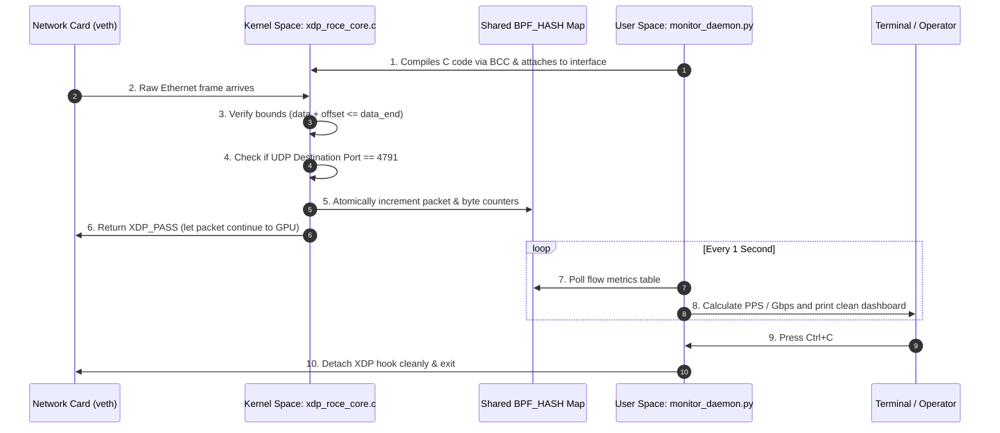

# Demystifying AI Cluster Telemetry: eBPF, XDP, and RoCEv2 Explained Simply

Welcome! If you are new to low-level Linux networking, kernel programming, and AI cluster infrastructure, this document will break down **what we are building**, **why it matters**, **the core Linux networking concepts involved**, and **how we will test it**.

---

## 1. The Big Picture: Why Are We Building This?

### The AI Scaling Problem
Modern Large Language Models (like GPT-4, Llama 3, or Gemini) contain hundreds of billions of parameters. They are far too large to fit inside a single GPU’s memory (VRAM). 

To train them, companies like Meta, Google, and Microsoft link thousands of GPUs together across high-speed networks. The GPUs do computation in parallel, and then—at regular intervals—they must **synchronize their results** with each other.

### The "Chorus" Analogy: How Distributed Training Works
Imagine a choir of 1,000 singers rehearsing a song. Every 10 seconds, the director blows a whistle, and all 1,000 singers must pause and agree on the pitch for the next verse before anyone is allowed to sing again. This synchronization step in AI is called **All-Reduce**.

Now imagine that **999 singers** finish their notes immediately, but **1 singer** has a sore throat, coughs, and takes 3 seconds longer to hit the note. 

What happens? **All 999 other singers sit in absolute silence, doing nothing, waiting for that single straggler.**

In an AI cluster:
* The singers are **GPUs** (e.g., NVIDIA H100s/B200s costing tens of thousands of dollars each).
* The sore throat is a **dropped network packet**, **a microsecond of network congestion**, or a **faulty switch queue**.
* When even one packet is delayed, thousands of GPUs halt computation, waiting for the missing data. 
* This is known in systems engineering as the **"Straggler Problem."** A tiny network delay of 0.1% can slash the effective computational output of a $100M cluster by 30% to 50%.

### Why Traditional Monitoring Tools Fail
If you want to catch network problems, why not just run standard tools like `tcpdump`, `wireshark`, or a Prometheus exporter?

Because of **CPU overhead and latency**.
* In a 400 Gbps or 800 Gbps AI cluster, **millions of packets arrive every single second**.
* Traditional tools inspect packets by copying each packet all the way from the network card, through the operating system kernel, into "User Space" (where normal programs live).
* This burns massive amounts of CPU power, generates context switches, and creates the very latency bottlenecks you were trying to diagnose! It's like putting a police checkpoint with a manual clipboard inspection in the middle of a Formula 1 race track.

---

## 2. Core Linux Networking Concepts: From First Principles

To solve this problem without slowing down the network, we operate at the lowest possible software layers in Linux. Here is a breakdown of the foundational concepts:

### A. User Space vs. Kernel Space
Think of your computer as a secure building:
* **User Space**: The lobby where normal applications run (Python, browsers, your terminal). Programs here have restricted permissions. If an app crashes, the computer keeps running.
* **Kernel Space**: The high-security control room where the operating system (Linux) lives. It directly controls hardware (CPUs, RAM, Network Cards). It has ultimate speed and power, but if something crashes here, the entire machine panics and reboots.

```
+--------------------------------------------------------+
|                      USER SPACE                        |
|   (Python Scripts, Web Browsers, Prometheus Exporters) |
+--------------------------------------------------------+
                           |  (Slow system calls & memory copies)
===========================v==============================
+--------------------------------------------------------+
|                     KERNEL SPACE                       |
|   (Linux TCP/IP Stack, Device Drivers, Memory Mgmt)    |
+--------------------------------------------------------+
                           |
+--------------------------------------------------------+
|                       HARDWARE                         |
|           (Network Interface Card - NIC, RAM)          |
+--------------------------------------------------------+
```

### B. The Traditional Linux Network Stack (The Slow Highway)
Normally, when a packet arrives at your network card (NIC):
1. The NIC places the packet in a hardware buffer.
2. The Linux driver allocates a complex data structure called an `sk_buff` (socket buffer).
3. The packet travels up through the Linux firewall (`iptables`/`nftables`), routing engine, and protocol layers (IP $\rightarrow$ UDP/TCP).
4. The OS wakes up the user application, and memory is copied from kernel space into user space.

At 400 Gbps, this multi-step journey is simply too slow for line-rate telemetry.

### C. Enter eBPF and XDP: The Ultra-Fast Bypass
* **eBPF (Extended Berkeley Packet Filter)**: 
  A revolutionary Linux technology that allows us to run custom, sandboxed mini-programs **inside the Linux kernel** on the fly, without modifying the kernel source code or rebooting. Think of it like running JavaScript inside a web browser, but inside the operating system kernel.
* **XDP (eXpress Data Path)**: 
  The fastest packet-processing hook in Linux. Instead of letting packets travel up the entire Linux network stack, XDP hooks into the packet **at the very earliest moment possible**—directly inside the network card's driver, before any `sk_buff` allocation or kernel processing happens.

```
                    PACKET ARRIVES AT NETWORK CARD
                                   |
                                   v
             [ XDP Hook (OUR CODE: xdp_roce_core.c) ]  <--- ZERO OVERHEAD!
              /                                    \
             /                                      \
    (If not RoCEv2: XDP_PASS)          (If RoCEv2: Update atomic counters)
           v                                         v
   Standard Linux Stack                   Save to shared BPF Map
   (TCP/IP, Sockets, etc.)                           |
                                                     v
                                       Python Daemon reads the Map!
```

### D. eBPF Maps: The Bridge Between Kernel and Python
Because kernel code cannot talk directly to Python, Linux provides **BPF Maps**.
* A BPF Map is an ultra-fast, in-memory key-value data store created in kernel memory.
* Our C code running in XDP writes packet counts to the map.
* Our Python script running in user space reads those counts once every second and displays clean graphs or metrics.
* **No packet copies, no system slowdown.**

### E. What is RoCEv2 and Port 4791?
* GPUs don't like using the CPU for networking. They use **RDMA (Remote Direct Memory Access)**, which lets GPU A write data directly into the memory of GPU B across the network.
* When RDMA runs over standard Ethernet cables, it is called **RoCEv2** (RDMA over Converged Ethernet version 2).
* By international standard, all RoCEv2 traffic is encapsulated inside regular **UDP packets on destination port 4791**.
* That is our target! Our program looks at every incoming packet: if it is UDP port 4791, we track it.

---

## 3. How We Are Going Low-Level

To turn these concepts into a production-grade tool, we will write two tightly coupled layers:



### The Kernel Layer (`src/xdp_roce_core.c`)
In C, accessing memory can easily crash a computer if you read past the end of a buffer (segmentation fault). 
The Linux Kernel has a built-in security guard called the **BPF Verifier**. The verifier inspects our C code before allowing it into the kernel:
1. **Bounds Checking**: Every time we read an Ethernet header, IP header, or UDP header, we must mathematically prove to the verifier that we are not reading past the end of the packet:
   ```c
   if ((void *)(cursor + sizeof(struct ethhdr)) > data_end)
       return XDP_PASS;
   ```
2. **Atomics (`__sync_fetch_and_add`)**:
   In an AI cluster, multiple CPU cores receive packets simultaneously. If Core 1 and Core 2 try to increment the packet counter at the exact same microsecond, they could overwrite each other. We use atomic CPU instructions to guarantee 100% counting accuracy without using slow locks.

### The User-Space Layer (`src/monitor_daemon.py`)
Written in Python using the **BCC (BPF Compiler Collection)** framework:
1. Compiles our C program using an embedded Clang compiler directly into kernel bytecode.
2. Attaches the hook to the network interface (`attach_xdp`).
3. Handles `Ctrl+C` (`SIGINT`) gracefully: if a monitor script crashes without cleaning up, the XDP hook could stay stuck in the kernel. Our script guarantees clean detachment.
4. Reads the raw 32-bit network integers and converts them to human-readable strings (e.g., `0xC0A86401` $\rightarrow$ `192.168.100.1`).

---

## 4. How We Will Test This Without Million-Dollar Hardware

You do not need a physical AI cluster or NVIDIA InfiniBand switches to test this. Linux has built-in network virtualization features that allow us to simulate an entire multi-host network inside your machine!

### The Testbed (`scripts/setup_testbed.sh`)
1. **Network Namespaces (`ip netns`)**:
   Think of a namespace like a lightweight virtual machine for networking. We will create two isolated rooms:
   * Room 1: `sim-ai-sender` (simulates a sending GPU node)
   * Room 2: `sim-ai-receiver` (simulates a receiving GPU node)
2. **Virtual Ethernet Pairs (`veth`)**:
   A `veth` pair is like a virtual network cable with two plugs. We plug one end (`veth-tx`) into `sim-ai-sender` and the other end (`veth-rx`) into `sim-ai-receiver`.
3. **Jumbo Frames (MTU 9000)**:
   Normal home internet packets are 1,500 bytes. AI clusters use 9,000-byte "Jumbo Frames" to reduce packet processing overhead. Our script configures this automatically.

### The Traffic Simulator (`tests/traffic_simulator.py`)
* We will write a Python script that injects raw UDP packets specifically targeted at **port 4791**.
* It simulates multiple parallel "flows" (different source ports and IP addresses), mimicking 8 GPUs synchronizing weights simultaneously.

---

## 5. What Outputs to Expect

When the system is running, here is exactly what you will see:

### Step 1: Setting up the Virtual Network
```bash
$ sudo bash scripts/setup_testbed.sh
[+] Creating isolated network namespaces: sim-ai-sender and sim-ai-receiver...
[+] Creating virtual Ethernet cable (veth-tx <---> veth-rx)...
[+] Configuring IP addresses (192.168.100.1 -> 192.168.100.2)...
[+] Setting MTU to 9000 (AI Fabric Jumbo Frames)...
[+] Disabling offload bottlenecks for predictable XDP processing...
[✓] AI Testbed successfully provisioned!
```

### Step 2: Running the Telemetry Monitor Daemon
In Terminal 1:
```bash
$ sudo python3 src/monitor_daemon.py --iface veth-rx
[INFO] Compiling XDP kernel program (src/xdp_roce_core.c)...
[INFO] Successfully attached XDP program to interface veth-rx (Mode: SKB/Generic).
[INFO] Monitoring RoCEv2 traffic on UDP port 4791... Press Ctrl+C to stop.

------------------------------------------------------------------------------------------
TIMESTAMP: 2026-10-16 00:15:32 | ACTIVE FLOWS: 4
SRC IP          SRC PORT   DST IP          DST PORT   PACKETS     BYTES        PPS      THROUGHPUT
------------------------------------------------------------------------------------------
192.168.100.1   52410      192.168.100.2   4791       45,120      406.08 MB    45.1k    3.25 Gbps
192.168.100.1   52411      192.168.100.2   4791       45,118      406.06 MB    45.1k    3.25 Gbps
192.168.100.1   52412      192.168.100.2   4791       44,980      404.82 MB    44.9k    3.24 Gbps
192.168.100.1   52413      192.168.100.2   4791       45,030      405.27 MB    45.0k    3.24 Gbps
------------------------------------------------------------------------------------------
TOTAL AGGREGATE BANDWIDTH: 12.98 Gbps | TOTAL PACKETS: 180,248
```

### Step 3: Injecting Simulated AI Traffic
In Terminal 2:
```bash
$ sudo ip netns exec sim-ai-sender python3 tests/traffic_simulator.py --target 192.168.100.2 --flows 4 --duration 10
[+] Initializing RoCEv2 synthetic traffic engine...
[+] Target: 192.168.100.2:4791 | Flows: 4 | Simulated Collective: NCCL All-Reduce Ring
[+] Pumping packets across 4 simulated Queue Pairs (QPs)...
[✓] Burst completed. Sent 180,248 packets (1.62 GB) across 4 flows.
```

### Step 4: Graceful Shutdown
When you press `Ctrl+C` in Terminal 1:
```bash
^C
[INFO] SIGINT detected. Detaching XDP hook from veth-rx...
[INFO] XDP hook detached successfully. Kernel clean. Exiting.
```

---

## 6. Summary Checklist Before We Start Coding

1. **Kernel C code (`src/xdp_roce_core.c`)**: High-speed, lockless packet parsing right at the NIC driver.
2. **User Daemon (`src/monitor_daemon.py`)**: User-friendly Python display and BCC compiler bridge.
3. **Testbed (`scripts/setup_testbed.sh`)**: Zero-hardware virtual network using Linux namespaces.
4. **Traffic Engine (`tests/traffic_simulator.py`)**: Generates real UDP 4791 packets simulating GPU weight synchronization.
5. **Documentation (`README.md`)**: A high-caliber engineering document ready to present to infrastructure teams at NVIDIA, Arista, and Cisco.
